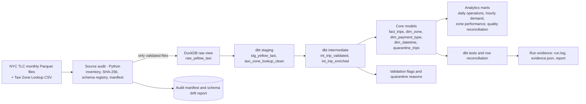

# Analytics Engineering Data Warehouse

A production-oriented analytics engineering pipeline built on **NYC TLC Yellow Taxi trip records**. It turns raw monthly
Parquet files into an auditable DuckDB warehouse with dbt models, data quality checks and reconciliation reports.

The project demonstrates large-scale data ingestion, schema-drift handling, memory-bounded processing, dimensional
modelling, data quality engineering and reproducible validation across **197M+ real trip records**.

**Tech stack:** Python · Parquet · DuckDB · dbt Core · SQLFluff · pytest · GitHub Actions (configured)

> **Project status.** The real-data warehouse build completed on 20 October 2026 and all 8 reconciliation checks passed.
> The **real-data benchmark (full refresh vs incremental) has not been run**: the real run used `--skip-benchmark`.
> Incremental-equals-full-refresh is proven on synthetic data only. See [Limitations](#9-limitations-and-future-work).

## 1. Key results

Measured on the real TLC files, 20 October 2026 (Windows 11, 8 CPUs, 8.3 GB RAM, DuckDB memory limit 6 GB).
Full report: [`docs/results/real-2022-2026_2026-10-20.md`](docs/results/real-2022-2026_2026-10-20.md) ·
evidence: [`docs/results/evidence/`](docs/results/evidence/) · summary: [`docs/results/FINAL_SUMMARY.md`](docs/results/FINAL_SUMMARY.md)

| Metric | Result |
|---|---|
| Real Parquet files processed | 56 (2022-01 to 2026-08, no missing months in that period) |
| Source records | 197,562,001 |
| Source data size | 3.29 GB (Parquet) |
| Warehouse build time (full load) | 1,197 s (19 min 57 s) |
| dbt execution steps passed | 434 (1 expected warning, 0 errors) |
| Reconciliation checks passed | 8 / 8 |
| Valid records in `fact_trips` | 197,539,104 |
| Quarantined records | 22,897 (0.0116%) |
| DuckDB database size | 8.60 GB |
| Real-data benchmark | **pending** |

## 2. Architecture



- **Ingestion.** Files are inventoried, checked for readability (a full read, not only the footer), checksummed with
  SHA-256, and compared with the data contract. Gaps, duplicate months and schema drift are reported. A file missing a
  required column is quarantined and never reaches the warehouse.
- **Warehouse.** DuckDB reads Parquet directly through a view. The loader processes **one monthly file at a time** under
  an absolute memory limit, so peak memory depends on one month, not on the whole history ([ADR 0004](docs/adr/0004-memory-bounded-loading.md)).
- **Transformation.** dbt builds staging, validation, dimensions, the fact table and marts, and runs the data tests.
- **Quality controls.** Row counts are reconciled across every layer; invalid records are classified and kept in a
  quarantine table with a reason; run evidence is saved.

Details: [`docs/architecture.md`](docs/architecture.md) · [`docs/data_lineage.md`](docs/data_lineage.md)

## 3. Data model and design decisions

| Decision | Choice |
|---|---|
| Grain of `fact_trips` | One retained **source record**. TLC publishes no trip identifier, so a row is not claimed to be a verified real-world trip. |
| Technical key | `trip_record_key` = md5(source file name : row number in file). Not a TLC id. |
| Dimensions | `dim_zone` (265 TLC zones plus an explicit *Unmapped* member), `dim_payment_type`, `dim_datetime` (hour grain) |
| Marts | `mart_daily_operations` (date × pickup zone), `mart_hourly_demand` (date × hour), `mart_zone_performance` (month × zone), `mart_quality_reconciliation` (one row per file) |
| Bad records | Never silently dropped. Records that break a quarantine rule go to `quarantine_trips` with a reason; warnings stay in the fact table and are reported. |
| Schema evolution | `union_by_name` plus `try_cast`; a column absent in a period becomes `NULL`; unknown columns are reported, not ignored ([data contract](config/data_contract.yml)). |
| Incremental strategy | `delete+insert` keyed on the monthly source file; a file whose checksum changes is reloaded, never appended ([ADR 0002](docs/adr/0002-incremental-strategy.md)). |
| Money and distance | `decimal(18,2)`, so sums do not depend on row order ([ADR 0003](docs/adr/0003-decimal-money.md)). |

Metric definitions: [`docs/metric_definitions.md`](docs/metric_definitions.md) · column definitions: [`docs/data_dictionary.md`](docs/data_dictionary.md)

### Source data used

| | |
|---|---|
| Dataset | NYC Taxi & Limousine Commission (TLC) **Yellow Taxi Trip Records** |
| Publisher | NYC TLC (data supplied to TLC by licensed taxi technology providers) |
| Format and naming | One Parquet file per month: `yellow_tripdata_YYYY-MM.parquet` |
| Period used | January 2022 to August 2026 (56 files; 12 months for each of 2022-2025, 8 for 2026) |
| Volume | 197,562,001 rows, 3.29 GB; 2.46M to 4.59M rows per month |
| Reference table | TLC Taxi Zone Lookup (265 zones: `LocationID`, `Borough`, `Zone`, `service_zone`) |
| Documentation | TLC *Data Dictionary – Yellow Taxi Trip Records*, 18 March 2025 |

| Year | Months | Source rows |
|---|---|---|
| 2022 | 12 | 39,656,098 |
| 2023 | 12 | 38,310,226 |
| 2024 | 12 | 41,169,720 |
| 2025 | 12 | 48,722,602 |
| 2026 (Jan-Aug) | 8 | 29,703,355 |
| **Total** | **56** | **197,562,001** |

**Columns carried into the warehouse:** `VendorID`, `tpep_pickup_datetime`, `tpep_dropoff_datetime`,
`passenger_count`, `trip_distance`, `RatecodeID`, `PULocationID`, `DOLocationID`, `payment_type`, `fare_amount`,
`tip_amount`, `total_amount`, `airport_fee`, `congestion_surcharge`, `cbd_congestion_fee`.
**Audited but not carried:** `store_and_fwd_flag`, `extra`, `mta_tax`, `tolls_amount`, `improvement_surcharge`
(not needed by the current marts) and `request_source` (not in the data dictionary; see below).

**Source semantics that affect the metrics** (from the TLC data dictionary): `tip_amount` contains credit-card tips only;
`total_amount` excludes cash tips; `trip_distance` is the taximeter distance in miles; `cbd_congestion_fee` is the MTA
Congestion Relief Zone charge starting 5 January 2025. TLC states that records come from technology providers and are not
guaranteed to be accurate, which is why the pipeline audits and quarantines rather than trusting the files.

**Schema versions seen in the real files:**

| Month | Observed change | Pipeline handling |
|---|---|---|
| 2023-02 | `airport_fee` is spelled `Airport_fee` from here on (43 files) | Reported as `renamed_case` drift; DuckDB merges names case-insensitively, staging reads one column |
| 2023-02 | Integer widths narrowed (`int64` to `int32`); `passenger_count` and `RatecodeID` change from double to int64 | `union_by_name` upcasts; staging uses `try_cast` |
| 2025-01 | `cbd_congestion_fee` added | Added to staging; `NULL` before 2025, non-NULL in every 2025-2026 row |
| 2026-06 | `request_source` (string) added; not in the 2025-03-18 data dictionary | Reported as `unknown_column` (warning); **not loaded** until its meaning is confirmed |

**The raw data is not stored in this repository** (3.29 GB of Parquet). Download it yourself from the official TLC source;
see [Data source and references](#10-data-source-and-references) and [Getting started](#6-getting-started). Only the small
Taxi Zone Lookup CSV (`warehouse/seeds/taxi_zone_lookup.csv`) and synthetic test fixtures are versioned.

## 4. Real-data validation results

**Source coverage.** All 56 audited monthly files from January 2022 through August 2026 were readable, with no missing
months within the audited period. Months after August 2026 were not part of this run.

**Reconciliation (8/8 checks passed).**
- Parquet footer rows = raw view = rows seen by validation = **197,562,001**
- Valid rows **197,539,104** + quarantined rows **22,897** = source rows
- `fact_trips` rows = valid rows; `quarantine_trips` rows = quarantined rows
- Per-file source rows = per-file Parquet footer rows; `trip_record_key` is unique within every file; every manifest file is loaded

**Quarantine.** Records removed from `fact_trips` are kept in `quarantine_trips` with their reason.

| Reason | Rows |
|---|---|
| `dropoff_before_pickup` | 19,908 |
| `pickup_outside_file_period` | 2,974 |
| `exact_duplicate_row` | 15 |
| **Total** | **22,897** |

65.9% of quarantined rows are in 2022. Isolated spikes appear in 2023-11, 2024-11 and 2025-11; their causes were not investigated.

**Warnings kept in the data (not removed, not adjusted).**
- **Negative `fare_amount`:** 4,371,395 rows (2.21%): 0.64% (2022), 1.00% (2023), 1.78% (2024), 5.85% (2025), 0.53% (2026).
  The cause was **not investigated**; `fare_amount` and `total_amount` totals include these rows.
- **Negative `trip_distance`:** 0. **Unmapped pickup zones:** 0 (zone IDs 264 *Unknown* and 265 *Outside of NYC* are valid
  lookup rows and count as mapped, so this does not mean every trip has a real NYC zone).

**Build.** 1,197 s, 434 dbt steps passed, 1 warning (`warn_negative_amounts`, a monitoring test), 0 errors; slowest file
2025-08 at 32.8 s. These are single measurements on one machine, not a performance claim for other hardware.

## 5. Implementation status

| Component | Status | Evidence |
|---|---|---|
| Data ingestion and source audit | Complete | Manifest and `raw_audit.json`; 56/56 files audited |
| DuckDB warehouse build | Complete on the tested dataset | Real-data report, 20 Oct 2026 |
| dbt transformations and tests | Complete for the tested build | 434 steps passed, 1 expected warning |
| Data reconciliation | Passed | 8/8 checks on 197,562,001 rows |
| Python and integration tests | Passed (28 tests, run on Linux; the integration test of the verification script also passed on the author's Windows machine) | `pytest -q` |
| SQL linting | Passed | `sqlfluff lint warehouse/models warehouse/tests` |
| Scale test on synthetic data | Passed | 225M synthetic rows under a 2 GB limit, [evidence](docs/results/evidence/) |
| GitHub Actions workflow | **Configured, not yet run** | `.github/workflows/ci.yml` |
| Docker image | Dockerfile provided, **not tested** | `Dockerfile` |
| Real-data performance benchmark | **Pending** | Full refresh vs incremental on the real files |
| Deployment and orchestration | Not implemented | Local pipeline; no cloud, Spark or orchestrator |

## 6. Getting started

**Requirements**
- Python 3.13 or newer (dependencies are pinned in `requirements.txt` for 3.13; the real run used Python 3.14.0 on Windows 11)
- Git
- Enough RAM and disk for the dataset: the tested run used 3.29 GB of raw files and produced an 8.60 GB DuckDB file, plus
  temporary spill space
- Dependencies from `requirements.txt`

**1. Create the environment**
```powershell
py -m venv .venv
.\.venv\Scripts\Activate.ps1          # Linux/macOS: python -m venv .venv && source .venv/bin/activate
python -m pip install --upgrade pip
pip install -r requirements.txt
```

**2. Prepare the source data.** Place the monthly TLC Parquet files in `data/raw/yellow_taxi/`, named
`yellow_tripdata_YYYY-MM.parquet`. Download them from the official TLC source (links below), or run:
```powershell
python scripts/download_data.py --start 2022-01 --end 2026-08
```
The downloader skips existing files, retries, and reports months TLC has not published as gaps. The raw dataset is not
included in this repository.

**3. Audit the source files**
```powershell
python scripts/run_pipeline.py audit
```
Review `data/manifests/raw_audit.json` for file coverage, schema changes, checksums and unreadable files.

**4. Run real-data verification** (build and checks, no benchmark)
```powershell
$env:DUCKDB_MEMORY_LIMIT = "6GB"
python scripts/verify_real_data.py --label real-2022-2026 --skip-benchmark
```
Configure `DUCKDB_MEMORY_LIMIT` according to available system memory. The documented real-data run used a 6 GB DuckDB memory
limit on a machine with 8.3 GB RAM; this setting is specific to the tested environment and should be adjusted for other
machines. Without the variable the pipeline uses about 60% of detected RAM.

Check the terminal output, the exit code (0 all checks passed, 1 blocking source problem, 2 a check failed), the report in
`docs/results/`, `reports/run_<timestamp>/run.log` and `evidence.json`. The log should start with the audit of your
`data/raw/yellow_taxi` folder and show the expected file count. Use `--continue-on-error` to load valid files when some are broken.

**5. Run tests and linting**
```powershell
python -m pytest -q                              # about 3 minutes; unit and dbt integration tests on synthetic fixtures
sqlfluff lint warehouse/models warehouse/tests
```

**6. Run the performance benchmark separately.** A real-data benchmark has **not** been completed for the reported run.
```powershell
python scripts/benchmark.py --help
python scripts/benchmark.py --last-n 6 --new-files 1     # example: the 6 most recent files, the last one added incrementally
```
The script compares full refresh with incremental loading on the same files and checks the outputs are row-for-row equal.

Individual stages can also be run with `python scripts/run_pipeline.py <audit|build-raw|transform|report|all>`.

**Output artifacts**
- `data/manifests/` – source audit manifests
- `docs/results/` – curated validation reports and evidence
- `reports/` – execution logs and run evidence
- DuckDB database files – generated warehouse data

Generated datasets, database files, virtual environments and temporary artifacts are not committed (see `.gitignore`).

## 7. Repository layout

| Path | Contents |
|---|---|
| `ingestion/` | inventory, validation, schema registry, manifest, downloader |
| `scripts/` | pipeline stages, real-data verification, benchmark, scale smoke test, fixture generator |
| `warehouse/` | dbt project: staging, intermediate, core and analytics models, macros, tests, zone-lookup seed |
| `config/data_contract.yml` | required fields, quality-rule severities, schema-evolution policy |
| `tests/` | unit tests, integration tests, shared fixtures |
| `docs/` | architecture, data dictionary, data quality, lineage, metric definitions, ADRs, results |
| `.github/` | CI workflow, pull-request and issue templates |

## 8. Testing and reproducibility

- **Tests:** 28 pytest tests (unit and dbt integration on synthetic fixtures with injected defects), SQLFluff, and 434 dbt
  steps on the real data. The integration tests assert that incremental output equals a full refresh, that replaying a
  month changes nothing, that a re-delivered file with different content is reloaded without duplicates, that the by-file
  load equals a single-pass build, and that a file missing a required column is quarantined.
- **Evidence:** run logs, `evidence.json`, dbt logs and generated reports are in `docs/results/` and `docs/results/evidence/`.
- **Reproducing the real-data numbers:** with the same 56 files, row counts, quarantine counts and reconciliation results are
  deterministic and should match the report; build time depends on the machine. The project was not a git repository
  when the real run was made, so the report records no commit hash.
- **Fixtures are synthetic.** `scripts/make_fixtures.py` generates random data with a TLC-like schema; it is not TLC data and
  says nothing about real data quality.

## 9. Limitations and future work

- The real-data benchmark of full refresh vs incremental has not been run; equivalence is proven on synthetic data only.
- Single-pass `dbt build` runs out of memory on the 197M-row dataset on an 8 GB machine, so by-file vs single-pass
  equivalence is also proven on synthetic data only. Table-wide key uniqueness is checked per file (ADR 0004).
- Negative fares are kept and reported; their cause has not been investigated.
- Duplicate detection works within each file only, not across months.
- One real run on one machine does not establish performance on other configurations.
- `request_source` is not loaded into the warehouse; the GitHub Actions workflow and the Docker image have not been run.
- Not implemented: cloud deployment, Spark, an orchestrator.

Possible next steps: run the real-data benchmark; investigate the negative-fare pattern and the quarantine spikes; add
cross-month duplicate detection; run the CI workflow and Docker image; decide how `request_source` should be modelled.

## 10. Data source and references

**Source data (download here; the files are too large to host in this repository)**
- NYC TLC Trip Record Data (official page, all trip types, monthly files, dictionaries and zone lookup):
  <https://www.nyc.gov/site/tlc/about/tlc-trip-record-data.page>
- Yellow Taxi monthly Parquet files follow this URL pattern (replace `YYYY-MM`), for example
  [`yellow_tripdata_2026-01.parquet`](https://d37ci6vzurychx.cloudfront.net/trip-data/yellow_tripdata_2026-01.parquet):
  `https://d37ci6vzurychx.cloudfront.net/trip-data/yellow_tripdata_YYYY-MM.parquet`
- Data dictionary (Yellow Taxi) and Taxi Zone Lookup: published on the TLC page above.

Check the TLC page for current terms of use and for the latest published month before downloading.
Data is published by NYC TLC; this project is not affiliated with or endorsed by TLC.

**Project documentation**
[Architecture](docs/architecture.md) · [Data dictionary](docs/data_dictionary.md) · [Data quality](docs/data_quality.md) ·
[Data lineage](docs/data_lineage.md) · [Metric definitions](docs/metric_definitions.md) ·
ADRs: [0001 warehouse](docs/adr/0001-warehouse-choice.md), [0002 incremental](docs/adr/0002-incremental-strategy.md),
[0003 decimal money](docs/adr/0003-decimal-money.md), [0004 memory-bounded loading](docs/adr/0004-memory-bounded-loading.md) ·
[Real-data report](docs/results/real-2022-2026_2026-10-20.md)

Licence: MIT (code). TLC data remains subject to the publisher's terms.
